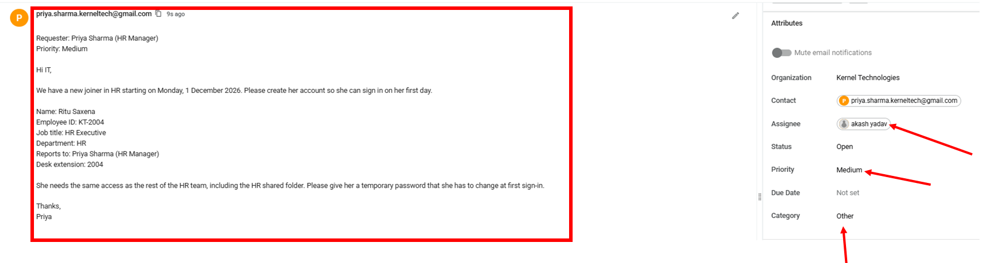
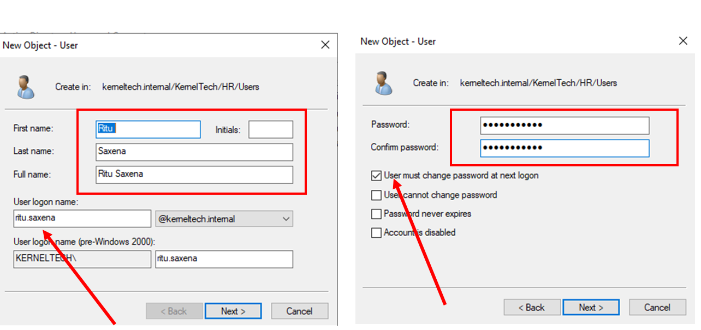
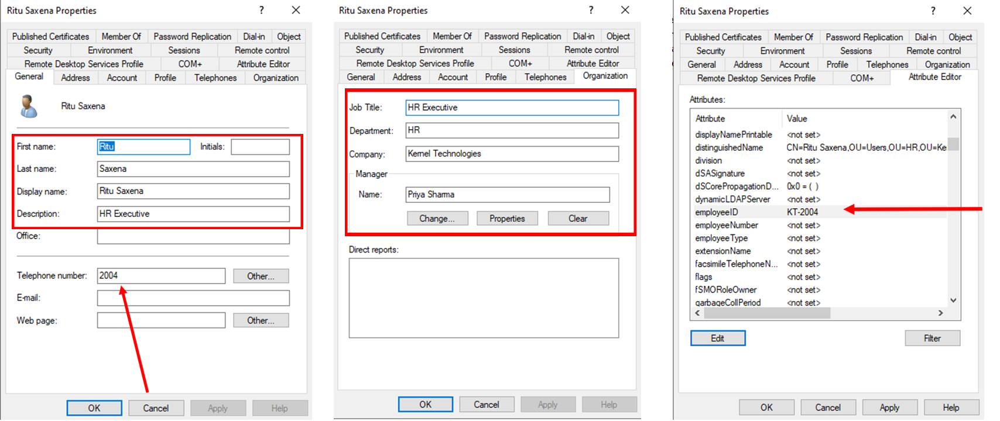
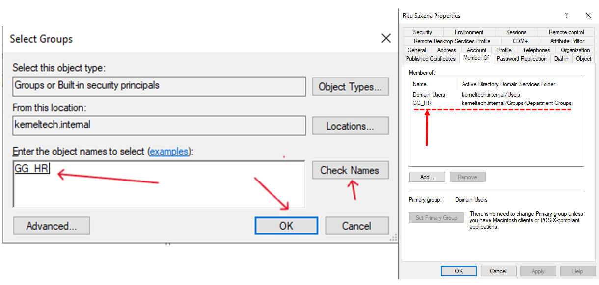
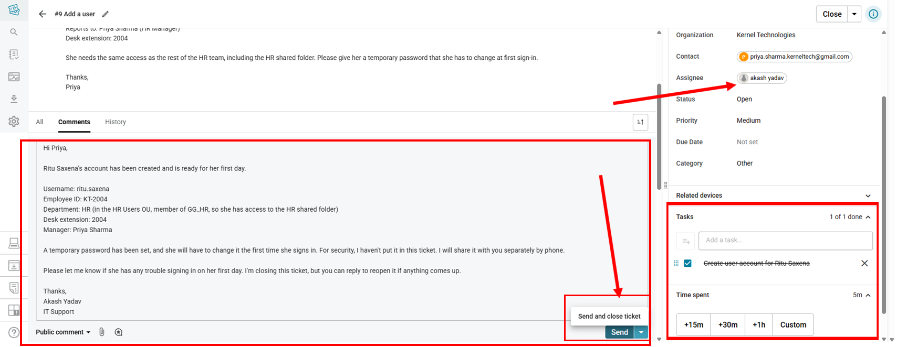
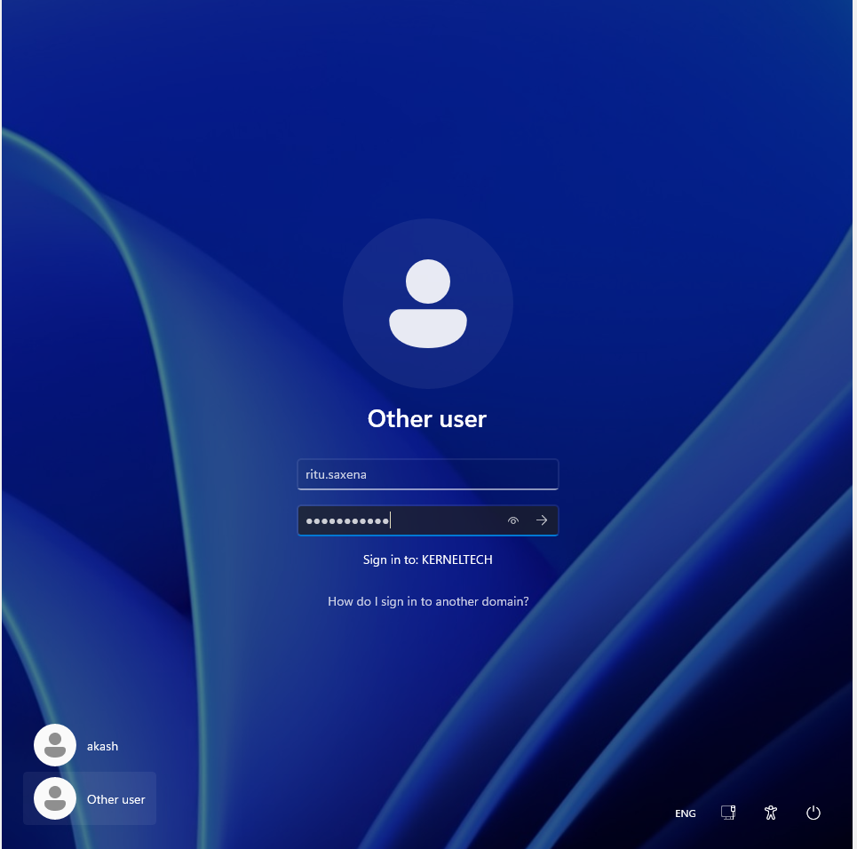
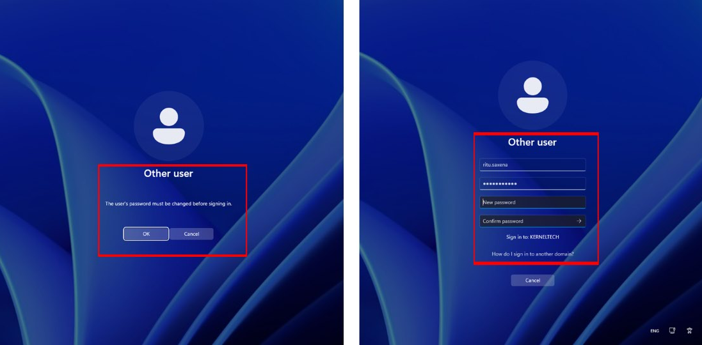

# Ticket #1

## Summary
Created a new user account for a new hire (Ritu Saxena) in Active Directory, set the password to change at first sign-in, and added her to the correct group. (Spiceworks ticket #9)

### Ticket in Spiceworks



Priya Sharma (HR Manager) requested a user account for a new employee, Ritu Saxena. All the necessary details were given, so no follow-up questions were needed.

Details given in the ticket:
- Name: Ritu Saxena
- Employee ID: KT-2004
- Job title: HR Executive
- Department: HR
- Reports to: Priya Sharma (HR Manager)
- Desk extension: 2004
- Priority: Medium

Steps taken in the ticket:
- Assigned the ticket to myself and set the category to `Other`
- Created the task `Create user account for Ritu Saxena`

### Creating the user account in ADUC

- Opened Active Directory Users and Computers (ADUC) and selected the correct OU for the department: `KernelTech > HR > Users`
- Right-clicked and chose `New > User`



- Filled in `First name`, `Last name` and `User logon name` (`ritu.saxena@kerneltech.internal`), then clicked **Next**
- Set a temporary password and ticked `User must change password at next logon`, so she sets her own password at first sign-in
- Clicked **Next**, then **Finish**

### Adding the necessary details

- Double-clicked the new user to open `Properties`



- **General tab**
    - Telephone number: `2004`
    - Description: `HR Executive`
- **Organization tab**
    - Job Title: `HR Executive`
    - Department: `HR`
    - Company: `Kernel Technologies`
    - Manager: `Priya Sharma` (`Change...` > enter name > `Check Names` > OK)
- **Employee ID**
    - Enabled `View > Advanced Features` in ADUC
    - In the user's properties, opened the `Attribute Editor` tab, found `employeeID` and set it to `KT-2004`

### Adding the user to GG_HR

So she can access the HR shared folder:

- In `Properties`, opened the `Member Of` tab and clicked `Add...`
- Entered `GG_HR`, clicked `Check Names`, then OK



> The account now has all the required details and group access, so I closed the ticket with a closing note.

### Closing the ticket

- Wrote the closing note
- Marked the task as done and logged the time spent (5 minutes)
- Clicked `Send and close ticket`



```
Hi Priya,

Ritu Saxena's account has been created and is ready for her first day.

Username: ritu.saxena
Employee ID: KT-2004
Department: HR (in the HR Users OU, member of GG_HR, so she has access to the HR shared folder)
Desk extension: 2004
Manager: Priya Sharma

A temporary password has been set, and she will have to change it the first time she signs in. For security, I haven't put it in this ticket. I will share it with you separately by phone.

Please let me know if she has any trouble signing in on her first day. I'm closing this ticket, but you can reply to reopen it if anything comes up.

Thanks,
Akash Yadav
IT Support
```

### Verification (lab only)

> This step is only to prove the account works in the lab. It is not part of the real ticket workflow.

- Signed in on `WKSTN-002` with the new credentials



- Windows showed "The user's password must be changed before signing in", which confirms the account works and the forced password change is active



**Result:** The account was created correctly and works as expected.