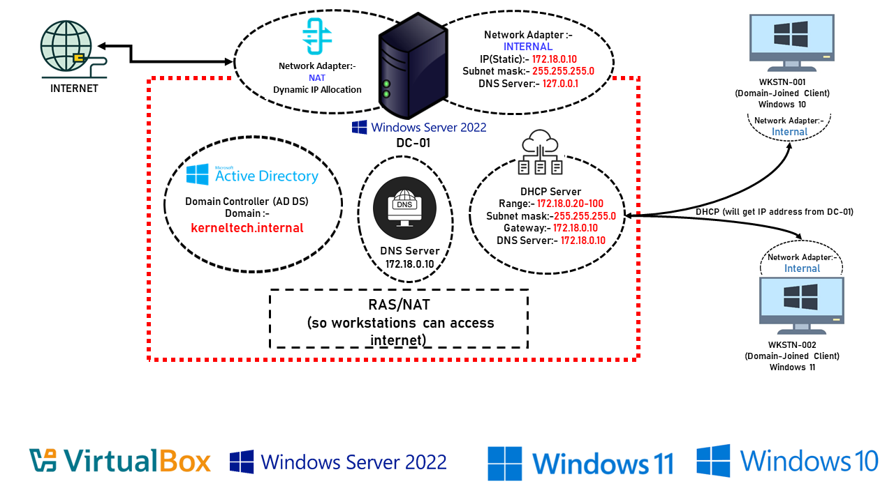
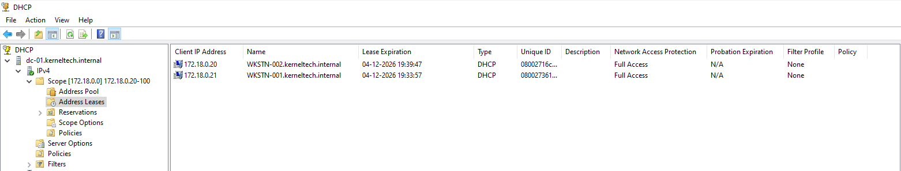
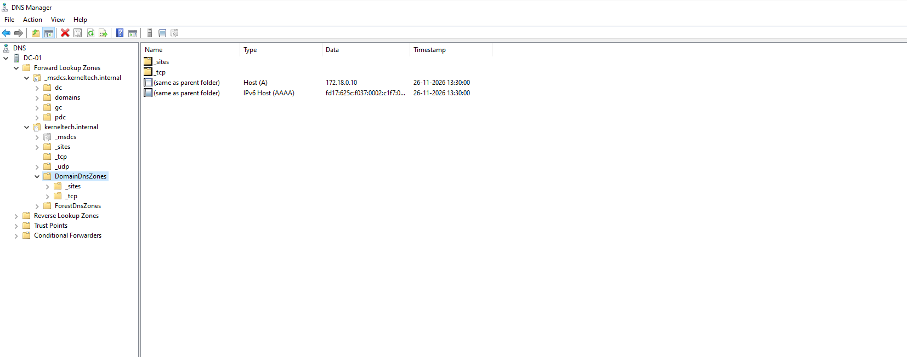
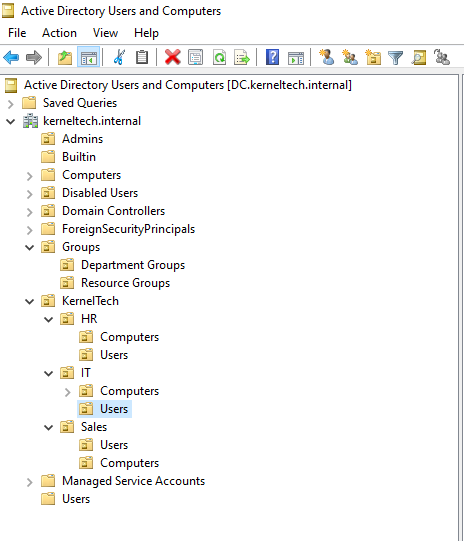

# Lab Environment

This is an Active Directory home lab built in VirtualBox for hands-on practice of AD administration and ticketing. It uses the domain **kerneltech.internal**, based on a fictional company, Kernel Technologies.



## Tools and Software

| Tool / Software | Version / Edition |
|---|---|
| VirtualBox | 7.1.12 r169651 (Qt 6.5.3) |
| Windows Server 2022 | Standard Evaluation |
| Windows 10 | Pro |
| Windows 11 | Enterprise Evaluation |
| Ticketing tool | Spiceworks |

## Virtual Machines

| VM | OS | Role |
|---|---|---|
| DC-01 | Windows Server 2022 | Domain controller (AD DS), DNS server, DHCP server, RAS/NAT router |
| WKSTN-001 | Windows 10 Pro | Domain-joined client |
| WKSTN-002 | Windows 11 Enterprise Evaluation | Domain-joined client |

## Network Design

**DC-01 has two network adapters:**

| Adapter | Type | Configuration |
|---|---|---|
| Adapter 1 | NAT | Gets its address from VirtualBox automatically. Gives DC-01 internet access through the host and keeps the lab hidden from the home network. |
| Adapter 2 | Internal network (<internal network name>) | Static IP 172.18.0.10, subnet mask 255.255.255.0, DNS server 127.0.0.1 (loopback, because DC-01 runs the DNS server itself) |

**DHCP scope on DC-01:**

| Setting | Value |
|---|---|
| Range | 172.18.0.20 – 172.18.0.100 |
| Subnet mask | 255.255.255.0 |
| Gateway | 172.18.0.10 (DC-01) |
| DNS server | 172.18.0.10 (DC-01) |

**Workstations** (WKSTN-001, WKSTN-002) each have one internal adapter. They get their IP settings from the DHCP server on DC-01 and reach the internet through RAS/NAT on DC-01.

## OU Structure

```
kerneltech.internal
├── KernelTech
│   ├── IT
│   │   ├── Users
│   │   └── Computers
│   ├── HR
│   │   ├── Users
│   │   └── Computers
│   └── Sales
│       ├── Users
│       └── Computers
├── Groups
│   ├── Department Groups   (global)
│   └── Resource Groups     (domain local)
├── Admins
└── Disabled Users
```

## Users

All users are fictional.

| Name | Job title | Department |
|---|---|---|
| Vikram Malhotra | IT Manager | IT |
| Akash Yadav | Systems Administrator | IT |
| Neha Kapoor | Helpdesk Technician | IT |
| Arjun Nair | Helpdesk Technician | IT |
| Priya Sharma | HR Manager | HR |
| Anita Desai | HR Executive | HR |
| Karan Bhatia | HR Executive | HR |
| Sanjay Bhatia | Sales Manager | Sales |
| Meera Joshi | Sales Executive | Sales |
| Rahul Singh | Sales Executive | Sales |
| Divya Menon | Sales Executive | Sales |

**Admin account:** Akash Yadav (Admin), username adm-akash.yadav, in the Admins OU and a member of Domain Admins. Akash also has a normal account in IT/Users for daily work.

## Groups

Users are placed in global groups by department. Each department group is then made a member of the domain local group for its shared folder. This follows the AGDLP pattern: Accounts go into Global groups, global groups go into Domain Local groups, and the domain local groups get the Permissions.

| Group | Scope | Description | Member of |
|---|---|---|---|
| GG_IT | Global | All IT department staff | DL_IT_SHARES |
| GG_HR | Global | All HR department staff | DL_HR_SHARES |
| GG_SALES | Global | All Sales department staff | DL_SALES_SHARES |
| GG_IT_HELPDESK | Global | Helpdesk technicians | |

These groups are in the Groups/Department Groups OU.

## Resource Groups

| Group | Scope | Description |
|---|---|---|
| DL_IT_SHARES | Domain Local | Access to the IT shared folder |
| DL_HR_SHARES | Domain Local | Access to the HR shared folder |
| DL_SALES_SHARES | Domain Local | Access to the Sales shared folder |

These groups are in the Groups/Resource Groups OU. Permissions on each shared folder are given to its domain local group, never to individual users.

## File Shares

Three shared folders are hosted on DC-01. Each gives Read access to the matching domain local group, set at both the share level and the NTFS level.

| Share | Hosted on | Share permission | NTFS permission | Group |
|---|---|---|---|---|
| IT_SHARES | DC-01 | Read | Read | DL_IT_SHARES |
| HR_SHARES | DC-01 | Read | Read | DL_HR_SHARES |
| SALES_SHARES | DC-01 | Read | Read | DL_SALES_SHARES |

## Screenshots

**DHCP address leases:** both workstations hold addresses from the 172.18.0.20–100 scope.



**DNS Manager, forward lookup zone kerneltech.internal:** host records for the domain controller and both workstations.



**Active Directory Users and Computers:** the OU structure.

